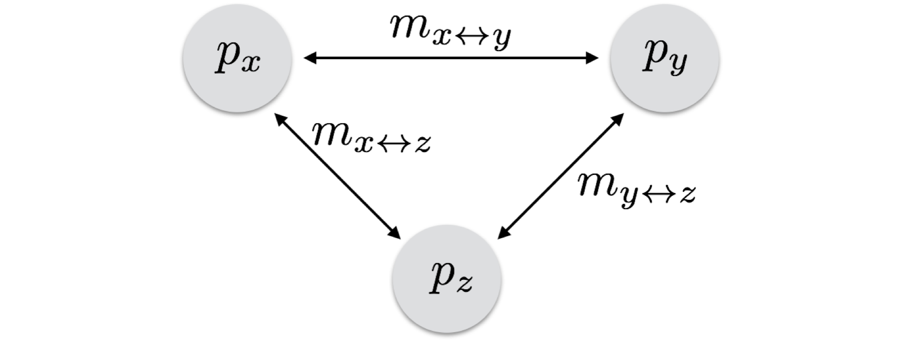

Population subdivision creates more realistic situations, in which individuals that are close together are more likely to mate with each other than with individuals in other locales.  You will see a lot of terminology for this (population, deme, locale, subdivision), all of which describe one or more factors that break the fundamental assumption of random mating.  In a subdivided population, an individual's probability of mating depends on which subdivision it lives in, and the subdivisions are connected by gene flow.

In this activity we focus on:

1. Understanding how migration rates and population connectivity affect allele frequencies,
2. Predicting future allele frequencies, and
3. Communicating those findings.

## Population Connectivity

Consider the following connectivity graph of the three populations *x*, *y*, and *z*.

{fig-alt="Three populations, x, y, and z, joined pairwise by two-headed arrows labeled m sub x y, m sub x z, and m sub y z."}

The populations start with these allele frequencies and exchange migrants at these rates.

```{r}
#| message: false
library( tidyverse )
px <- 0.2
py <- 0.8
pz <- 0.9
mxy <- 0.1
mxz <- 0.2
myz <- 0.3
```

We will follow them for 100 generations, so set up a `data.frame` with one row per generation and the starting frequencies in the first row.

```{r}
N <- 100

df <- data.frame( Generation = seq( 0, N ),
                  px = c( px, rep( NA, N ) ),
                  py = c( py, rep( NA, N ) ),
                  pz = c( pz, rep( NA, N ) ) )
head( df )
```

Each generation, every population is a mixture of its residents and the immigrants from the populations it is connected to (see [The General Model](https://dyerlabteaching.github.io/PopulationSubdivision/narrative.html#sec-general-model) in the narrative).

```{r}
for( i in 2:nrow( df ) ) {
  df$px[i] <- df$px[i - 1] * (1 - (mxy + mxz)) + df$py[i - 1] * mxy + df$pz[i - 1] * mxz
  df$py[i] <- df$py[i - 1] * (1 - (mxy + myz)) + df$px[i - 1] * mxy + df$pz[i - 1] * myz
  df$pz[i] <- df$pz[i - 1] * (1 - (mxz + myz)) + df$px[i - 1] * mxz + df$py[i - 1] * myz
}
```

```{r}
pivot_longer( df, cols = c( px, py, pz ), names_to = "Population", values_to = "Frequency" ) |>
  ggplot( aes( Generation, Frequency, color = Population ) ) +
  geom_line() +
  theme_minimal()
```

## Questions

Use the code above to answer the following.

1. What if $m_{y \leftrightarrow z} = 0$?  How does that change the trajectories of the allele frequencies, and where do they end up?

```{r}
# set myz = 0, rerun the simulation, and plot the allele frequencies for each population
```

2. Reset the connectivity to the original rates and add a fourth population, `w`, that receives migrants by **one-way** gene flow from population `z` at a rate of $m_{z \rightarrow w} = 0.05$, starting at an allele frequency of 0.1.  Plot the allele frequencies through time for enough generations that the whole system reaches equilibrium.

```{r}
# add population w and plot the allele frequencies
```

3. Where does `w` end up, and why there?  Does adding `w` change the allele frequencies of `x`, `y`, or `z`?
