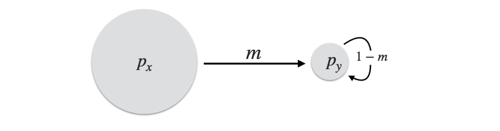
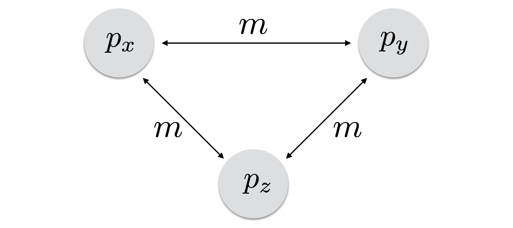
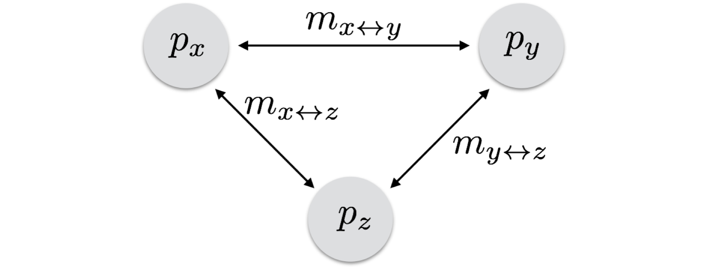

<!-- BEGIN module:header -->

{fig-alt="Looking down over green desert scrub and rocky ridges to the Sea of Cortez south of Loreto, Baja California, with a small rocky island and a distant larger one offshore."}

> Few species mate at random across their whole range.  Once a population is broken into pieces, each piece follows its own allele frequencies, and gene flow is the thread that pulls them back together.

<!-- END module:header -->

Subdivision occurs when individuals are spatially, ecologically, or temporally separated, so that the probability of mating is not spread evenly across all individuals.  This is the natural state for most species.  They are not one randomly mating population, and the way they are broken up changes how genetic variation is partitioned among the pieces.  This module examines the classic models that describe how subdivided populations are connected, and what those connections do to allele frequencies through time.

Before descending into the models, two terms that are often used interchangeably need to be kept apart:

- **Migration** is the movement of individuals among spatial locations.  It does not, strictly speaking, imply anything about mating.  Birds, mammals, and even insects migrate in response to the seasons, but moving toward the equator for the winter does not by itself change the genetic composition of any population.
- **Gene flow** is the movement of genetic material between locales or populations that results in a change to their standing genetic variation.  It is usually expressed as a rate, $m$, a fraction between 0 and 1, and it acts directly on allele and genotype frequencies.

Migration may lead to mating, and so to gene flow, but it does not require it.  The models below are models of gene flow: $m$ is the fraction of a population's breeding individuals in a generation that are immigrants.  In this module we cover:

1. Describing subdivided populations as a network of populations connected by gene flow,
2. The island–mainland, island, and stepping-stone models of connectivity,
3. A general model that works for any network, and
4. Simulating allele frequency change on these networks in R.

## Populations as Networks {#sec-networks .theory}

If individuals are partitioned into groups, the expected allele and genotype frequencies in each group depend on how the groups are connected by gene flow.  There are a few classic models of connectivity.  Real populations almost certainly fall outside their strict conventions, but the models give us a framework for interpreting observed distributions of genetic variation and for predicting future structure from a few assumptions.

A network analogy is useful here.  Each population is a **node**, and gene flow between two populations is an **edge** connecting them.  Strictly speaking this is a *weighted* graph, because each edge carries a migration rate, and it may be *directed*, because gene flow from $x$ into $y$ need not equal gene flow from $y$ into $x$.  Each population has its own allele frequencies.  From one generation to the next, a population's allele frequencies change in response to **immigration** into it, but not emigration out of it, because we assume that which individuals leave is independent of their genotypes.

## The Island–Mainland Model {#sec-island-mainland .theory}

The island–mainland model is the simplest model of subdivision: a large mainland population and a small island population, with allele frequencies $p_x$ and $p_y$.  Each generation a fraction $m$ of the island's breeding individuals are immigrants from the mainland, and the remaining $(1-m)$ were already on the island.  Nothing moves from the island back to the mainland.

{#fig-island-mainland fig-alt="Two circles, a large one labeled p sub x for the mainland and a small one labeled p sub y for the island, joined by a single arrow from mainland to island labeled m."}

The mainland is assumed to be large enough that losing a few emigrants does not change its allele frequencies, so $p_x$ stays constant.  The island in the next generation is a mixture of $m$ immigrants, whose frequency is $p_x$, and $(1-m)$ residents, whose frequency was $p_{y,t}$:

$$
p_{y,t+1} = (1-m)\,p_{y,t} + m\,p_x
$$

Applying this recursion over and over gives the island's frequency after $t$ generations directly:

$$
p_{y,t} = p_x + (p_{y,0} - p_x)(1-m)^t
$$

The difference between the island and the mainland, $p_{y,0} - p_x$, shrinks by a factor of $(1-m)$ every generation.  This is the same kind of geometric decay we saw for allele frequencies under recurrent [mutation](https://dyerlabteaching.github.io/Drift-and-Mutation/narrative.html), and it has three consequences:

- The island always ends up with the mainland's frequency, $p_x$.  Because gene flow runs only one way, the mainland sets the equilibrium.
- How long it takes depends on the size of the initial difference and on $m$.
- The time to close *half* the difference is $t_{1/2} = \ln(0.5) / \ln(1-m) \approx 0.69/m$ generations.  At $m = 0.01$ that is about 69 generations, and at $m = 0.10$ fewer than 7.  Even small amounts of gene flow overwhelm an island quickly on an evolutionary time scale.

## The Island–Mainland Model in R {#sec-island-mainland-r .application}

To see the effect of the migration rate, we can iterate the recursion for an island that starts fixed for an allele ($p_{y,0} = 1$) that is absent from the mainland ($p_x = 0$), under four different values of $m$.  The outer loop runs over the migration rates, the inner loop over generations, and the trajectory for each rate is appended to a `data.frame`.

```{r}
#| message: false
library( ggplot2 )

m_values <- c( 0.01, 0.05, 0.10, 0.15 )
T <- 100
px <- 0

results <- data.frame()
for( m in m_values ) {
  p <- numeric( T + 1 )
  p[1] <- 1
  for( t in 1:T ) {
    p[t + 1] <- (1 - m) * p[t] + m * px
  }
  results <- rbind( results, data.frame( m = m, Generation = 0:T, p = p ) )
}
results$m <- factor( results$m )
```

```{r}
#| label: fig-island-mainland-sim
#| fig-cap: "Allele frequency on an island that starts fixed for an allele absent from the mainland, under four migration rates."
#| fig-alt: "Four curves of island allele frequency falling from 1 toward 0 over 100 generations; the curve for m = 0.15 drops fastest and the curve for m = 0.01 has only fallen to about 0.37 by generation 100."
ggplot( results, aes( x = Generation, y = p, color = m ) ) +
  geom_line() +
  ylab( "Island allele frequency (p)" ) +
  theme_minimal()
```

The recursion and the closed-form expression give the same answer.  Here is the check for the last rate in the loop, $m = 0.15$, along with the half-life of the difference for each rate.

```{r}
all.equal( p, px + (1 - px) * (1 - m)^(0:T) )
log( 0.5 ) / log( 1 - m_values )
```

## The Island Model {#sec-island-model .theory}

The next step up in complexity is a model in which every population exchanges migrants with every other.  This **$n$-island model** was introduced by Sewall Wright (1931): all populations are connected by the same constant migration rate, so an allele that arises by mutation in one population can reach any other in a single generation, with a probability set by $m$.

{#fig-island-model fig-alt="Three circles labeled p sub x, p sub y, and p sub z, each joined to the other two by two-headed arrows labeled m."}

This system is very stable.  Every population shares migrants with every other, so all of them converge on a single allele frequency: the global average, $\bar{p}$.  How long each population takes depends on how far it starts from $\bar{p}$ and on $m$.

The simplest way to model it is to treat the migrants as one large **migrant pool** with the global average frequency, $\bar{p}$, from which every population draws its immigrants.  Under that approximation, population $X$ in the next generation is:

$$
p_{x,t+1} = (1-m)\,p_{x,t} + m\,\bar{p}
$$

This has exactly the form of the island–mainland model, with the migrant pool playing the part of the mainland.  So, as for mutation and inbreeding, if we know the starting frequency, $p_0$, the migration rate, $m$, and the number of generations, $t$, the frequency at any time in the future is:

$$
p_t = \bar{p} + (p_0 - \bar{p})(1-m)^t
$$

The migrant pool stays at $\bar{p}$ only because migration is symmetric and the populations are the same size: every population gives as much as it receives, so the global average is conserved while the individual populations converge on it.

### Underlying Assumptions

The salient assumptions of this model are:

- Generations do not overlap, so connectivity can be described with a difference equation from one generation to the next.
- Populations are discrete, with clear breaks between them.
- Migration rates are constant through both space and time.
- Migration is symmetric in both directions.

This is not the most realistic model, but it outlines a general way to predict allele frequencies through time.

## The Island Model in R {#sec-island-model-r .application}

Consider four island populations starting at $p_0 = 0.1$, $0.3$, $0.7$, and $0.9$, whose average is $\bar{p} = 0.5$, exchanging migrants at $m = 0.05$ each generation.  Because we have the closed-form expression, we can calculate every generation of a population at once instead of looping over generations.

```{r}
T <- 100
m <- 0.05
p0 <- c( 0.1, 0.3, 0.7, 0.9 )
pbar <- mean( p0 )

islands <- data.frame()
for( i in 1:length( p0 ) ) {
  Generation <- 0:T
  Frequency <- pbar + (p0[i] - pbar) * (1 - m)^Generation
  islands <- rbind( islands,
                    data.frame( Population = paste( "Island", i ),
                                Generation = Generation,
                                Frequency = Frequency ) )
}
```

```{r}
#| label: fig-island-model-sim
#| fig-cap: "Allele frequencies in four island populations exchanging migrants at $m = 0.05$ through a migrant pool with $\\bar{p} = 0.5$."
#| fig-alt: "Four curves starting at 0.1, 0.3, 0.7, and 0.9 that converge symmetrically on 0.5 over 100 generations, the outer two taking longest to arrive."
ggplot( islands, aes( x = Generation, y = Frequency, color = Population ) ) +
  geom_line() +
  geom_hline( yintercept = pbar, linetype = "dashed" ) +
  ylab( "Allele frequency" ) +
  theme_minimal()
```

The populations converge on the dashed line at $\bar{p}$.  Populations further from $\bar{p}$ change faster in absolute terms, but every population closes the same *fraction* of its remaining distance each generation.

## Stepping-Stone Models {#sec-stepping-stone .theory}

A somewhat more realistic model was introduced by Kimura & Weiss (1964), who coined the term **stepping-stone model** for a model that takes the spatial arrangement of populations into account.  Populations sit in a line, and each one exchanges migrants only with its immediate neighbors.

{#fig-stepping-stone fig-alt="A row of three circles labeled p sub i minus 1, p sub i, and p sub i plus 1, with paired arrows between each neighbor labeled m over 2 and paired arrows leading off each end of the row."}

Their model is an infinite line of populations sharing a single migration rate, $m$.  For any population, $i$, the allele frequency in the next generation depends on:

- Its own frequency in the current generation, $p_{i,t}$.
- The migrants arriving from each side.  The total rate is $m$, so each neighbor contributes immigrants at rate $\frac{m}{2}$ every generation, and each neighbor has its own frequency that is itself changing through time.
- A "background" level of long-distance migration, at rate $m_\infty$, from a pool with frequency $\bar{p}$.  This term can be hard to parameterize; said another way, it is a convenient buffer in the model for the things you can't explain directly.
- A random change in allele frequency each generation, $\eta_i$, from genetic drift and other local processes.  Its expectation is $E[\eta_i] = 0$ and its variance is $E[\eta_i^2] = \frac{p_i(1-p_i)}{2N_e}$, the variance we saw for [genetic drift](https://dyerlabteaching.github.io/Drift-and-Mutation/narrative.html).

Taken together:

$$
p_{i,t+1} = (1 - m - m_\infty)\,p_{i,t} + \frac{m}{2}\left(p_{i-1,t} + p_{i+1,t}\right) + m_\infty\,\bar{p} + \eta_i
$$

They extended the model to two dimensions, with populations arranged on a grid of rows and columns, and briefly considered three.

```{dot}
//| label: fig-stepping-stone-2d
//| fig-cap: "The two-dimensional stepping-stone model.  Populations sit on a grid and exchange migrants only with their neighbors in the same row or column."
//| fig-alt: "A three by three grid of circles, each joined by two-headed arrows to the circles beside it, above it, and below it."
graph grid {
  graph [layout=neato, bgcolor="transparent"];
  node  [shape=circle, style=filled, fillcolor="#e0e0e0", color="#999999", label="", width=0.45];
  edge  [dir=both, arrowsize=0.6, color="#333333"];
  a [pos="0,2!"]; b [pos="1,2!"]; c [pos="2,2!"];
  d [pos="0,1!"]; e [pos="1,1!"]; f [pos="2,1!"];
  g [pos="0,0!"]; h [pos="1,0!"]; i [pos="2,0!"];
  a -- b; b -- c; d -- e; e -- f; g -- h; h -- i;
  a -- d; d -- g; b -- e; e -- h; c -- f; f -- i;
}
```

For each arrangement they derived how the genetic correlation between two populations decreases as the distance between them grows.  Perhaps not surprisingly, the correlation is higher in one-dimensional arrangements than in two-dimensional ones, and higher in two dimensions than in three.  Their paper is an excellent introduction to the mathematics of connectivity in discrete space and is worth reading in detail if you want to model it more completely.  Here we turn instead to a more general approach based on a specified network of connectivity.

## The General Model {#sec-general-model .theory}

A broader approach, which covers all of the models above, is to specify the topology of the connectivity network directly and then predict allele frequency change on it.  Instead of one migration rate for every population or a rigid geometric arrangement, each pair of connected populations gets its own rate.  Start with three populations, each with its own frequency and each pair connected by its own migration rate.

{#fig-general-model fig-alt="Three circles labeled p sub x, p sub y, and p sub z, joined pairwise by two-headed arrows labeled m sub x y, m sub x z, and m sub y z."}

Population $X$ in the next generation is made of immigrants from each population it is connected to, at that population's frequency in the current generation, plus its residents, the fraction that are not immigrants, at its own current frequency:

$$
p_{x,t+1} = m_{x \leftrightarrow y}\,p_{y,t} + m_{x \leftrightarrow z}\,p_{z,t} + \left[1 - (m_{x \leftrightarrow y} + m_{x \leftrightarrow z})\right] p_{x,t}
$$

In the same way, the other two populations are:

$$
p_{y,t+1} = m_{x \leftrightarrow y}\,p_{x,t} + m_{y \leftrightarrow z}\,p_{z,t} + \left[1 - (m_{x \leftrightarrow y} + m_{y \leftrightarrow z})\right] p_{y,t}
$$

$$
p_{z,t+1} = m_{x \leftrightarrow z}\,p_{x,t} + m_{y \leftrightarrow z}\,p_{y,t} + \left[1 - (m_{x \leftrightarrow z} + m_{y \leftrightarrow z})\right] p_{z,t}
$$

### The Migration Matrix

These are one equation per population, and all three have the same structure: each new frequency is a weighted average of the current frequencies, with weights given by the migration rates.  Collect the frequencies into a vector, $\mathbf{p}_t$, and the weights into a **migration matrix**, $\mathbf{M}$, whose entry in row $i$ and column $j$ is the fraction of population $i$'s breeders that came from population $j$:

$$
\mathbf{M} =
\begin{bmatrix}
1 - (m_{xy} + m_{xz}) & m_{xy} & m_{xz} \\
m_{xy} & 1 - (m_{xy} + m_{yz}) & m_{yz} \\
m_{xz} & m_{yz} & 1 - (m_{xz} + m_{yz})
\end{bmatrix}
\qquad
\mathbf{p}_{t+1} = \mathbf{M}\,\mathbf{p}_t
$$

This works for any number of populations and any network.  Each row sums to one, because every breeder in a population is either a resident or an immigrant from somewhere.  A population that receives no immigrants from $j$ has a zero in column $j$, and one-way gene flow shows up as a nonzero entry on one side of the diagonal with a zero in the mirror position.

### What the Model Tells Us

A few general points follow from this model:

- The rate at which a population's allele frequency changes depends both on how different it is from the populations sending it migrants and on how much gene flow it receives.  Populations with more gene flow approach equilibrium faster.
- When gene flow is symmetric between populations of equal size, as in the island model, the global average, $\bar{p}$, is conserved and every population converges on it.
- When gene flow is one-way, as in the island–mainland model, the equilibrium is set by the **source** populations, those that send migrants into the rest of the network but receive none from it, and not by the average of all populations.
- Depending on the configuration of the network, a population's allele frequency can first move *away* from its eventual equilibrium before turning back.  If it is more strongly connected to a population that is far from $\bar{p}$ on one side, it is pulled toward that population first.

## The General Model in R {#sec-general-model-r .application}

Here we follow three populations, starting at different allele frequencies, for $T = 75$ generations.

```{r}
T <- 75
pX <- rep( NA, T + 1 )
pY <- rep( NA, T + 1 )
pZ <- rep( NA, T + 1 )
pX[1] <- 0.1
pY[1] <- 0.5
pZ[1] <- 0.9
```

The populations exchange migrants at different rates.  For this example the exchange is symmetric, but it does not have to be, and the code below is easily extended to asymmetric rates.

```{r}
mXY <- 0.04
mXZ <- 0.02
mYZ <- 0.08
```

Each generation, every population is updated from the previous generation's frequencies of the populations its immigrants come from.  The three lines inside the loop are the three equations of the general model.

```{r}
for( gen in 2:(T + 1) ) {
  pX[gen] <- mXY * pY[gen - 1] + mXZ * pZ[gen - 1] + (1 - (mXY + mXZ)) * pX[gen - 1]
  pY[gen] <- mXY * pX[gen - 1] + mYZ * pZ[gen - 1] + (1 - (mXY + mYZ)) * pY[gen - 1]
  pZ[gen] <- mXZ * pX[gen - 1] + mYZ * pY[gen - 1] + (1 - (mXZ + mYZ)) * pZ[gen - 1]
}

df <- data.frame( Generation = rep( 0:T, times = 3 ),
                  Frequency = c( pX, pY, pZ ),
                  Population = rep( c( "X", "Y", "Z" ), each = T + 1 ) )
```

```{r}
#| label: fig-general-model-sim
#| fig-cap: "Allele frequencies in three populations exchanging migrants at $m_{x \\leftrightarrow y} = 0.04$, $m_{x \\leftrightarrow z} = 0.02$, and $m_{y \\leftrightarrow z} = 0.08$."
#| fig-alt: "Three curves starting at 0.1, 0.5, and 0.9 that converge on 0.5. The middle curve, Y, first rises toward Z before settling back toward 0.5."
ggplot( df, aes( x = Generation, y = Frequency, color = Population ) ) +
  geom_line() +
  ylab( "Population allele frequency" ) +
  theme_minimal()
```

Migration here is symmetric and the populations are treated as equal, so they converge on the average of the starting frequencies:

```{r}
mean( c( pX[1], pY[1], pZ[1] ) )
c( pX[T + 1], pY[T + 1], pZ[T + 1] )
```

Two things stand out in @fig-general-model-sim.  $Z$ approaches the average faster than $X$, because $Z$ has more gene flow overall ($m_{x \leftrightarrow z} + m_{y \leftrightarrow z} = 0.10$) than $X$ ($m_{x \leftrightarrow y} + m_{x \leftrightarrow z} = 0.06$).  And $Y$ starts *at* the average but first moves away from it, toward $Z$, because it exchanges twice as many migrants with $Z$ as with $X$.

### The Same Model as a Matrix

The loop above needs one line per population, which becomes unwieldy for larger networks.  The migration matrix does the same work in one step for any number of populations.  Build $\mathbf{M}$ row by row, check that every row sums to one, and multiply it by the vector of frequencies with `%*%` once per generation.

```{r}
M <- matrix( c( 1 - (mXY + mXZ), mXY,             mXZ,
                mXY,             1 - (mXY + mYZ), mYZ,
                mXZ,             mYZ,             1 - (mXZ + mYZ) ),
             nrow = 3, byrow = TRUE )
rowSums( M )

p <- c( 0.1, 0.5, 0.9 )
for( gen in 1:T ) {
  p <- M %*% p
}
p
```

The result is identical to the last generation of the loop.

### How Long Until Equilibrium?

An allele frequency approaches equilibrium geometrically, so it never quite arrives.  A practical stopping rule is the first generation at which *every* population is within some small tolerance, say $0.01$, of the equilibrium frequency.  `pmax()` gives, for each generation, the largest difference among the three populations, and the smallest generation at which that difference is below the tolerance is the answer.

```{r}
pbar <- mean( c( pX[1], pY[1], pZ[1] ) )
max_diff <- pmax( abs( pX - pbar ), abs( pY - pbar ), abs( pZ - pbar ) )
min( (0:T)[ max_diff < 0.01 ] )
```

This is also a reminder that a simulation needs a **burn-in**.  The equilibrium we are interested in is reached only after the whole system has run for many generations and the early idiosyncrasies, like the initial rise in $Y$, have worked themselves out.

## General Strategies {#sec-strategies .theory}

A few general rules make these dynamical systems much easier to understand.  There are always exceptions, but following them will save you a lot of trouble:

1. **Draw the network.**  If it is too complicated to draw completely, at least sketch the main flows.  Seeing the structure is the best guide to where the allele frequencies should be going.
2. **Know where it should end up.**  In most systems every population tends toward $\bar{p}$ given enough time.  Where populations are isolated ($m = 0$) or gene flow is one-way, as in the island–mainland model, parts of the network will never settle on $\bar{p}$; their equilibrium is set by the populations they receive migrants from.
3. **Iterate slowly and sanity-check.**  Once the model is specified, step through the first few generations and check that each population is being updated with the right rates and the right source frequencies.  There are endless ways to get it wrong through a typo, and a wrong model still produces a plausible-looking plot.

With these strategies, you should be able to work out the behavior of any arrangement of populations.
