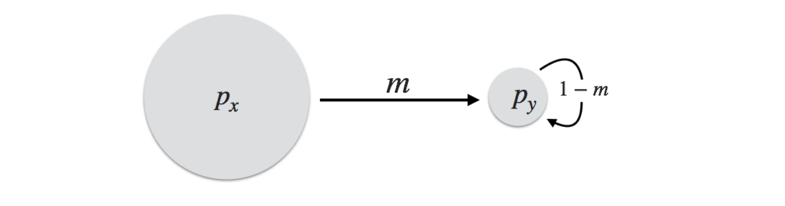
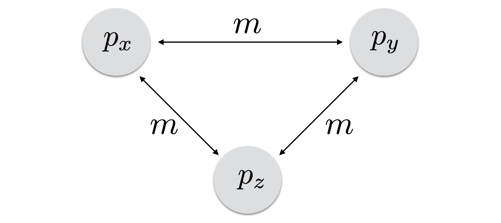
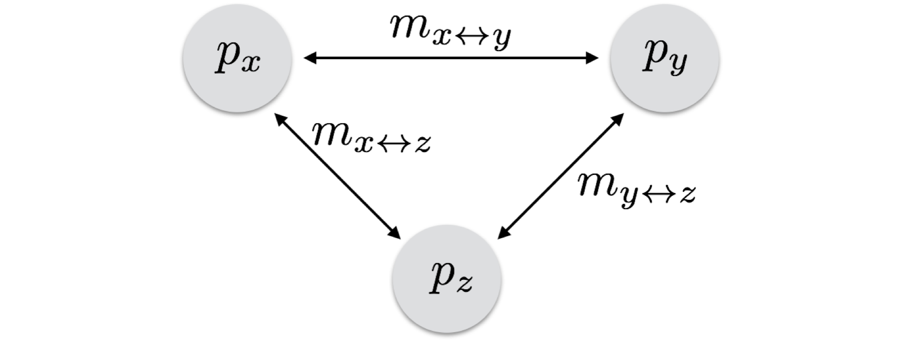

```{r}
#| echo: false
#| message: false
#| warning: false
library(ggplot2)
theme_set(theme_minimal(base_size = 16))
```


## Learning Objectives {.smaller}

**Model Gene Flow Among Subdivided Populations**

- Describe how the island–mainland, island, stepping-stone, and general models connect populations.
- Write the recursion that predicts each population's allele frequency in the next generation.

**Predict Allele Frequency Change Under Gene Flow**

- Simulate allele frequencies through time on a connectivity network in R.
- Determine the equilibrium, how long it takes to reach it, and which populations set it.


## Jargon

**Migration**

> The movement of individuals among spatial locations.

&nbsp;

**Gene Flow**

> The movement of genetic material between locales or populations that results in a change to their standing genetic variation.

::: {.fragment}
Migration *may* lead to gene flow, but it does not require it.
:::


# Population Models {background-color="black" background-image="media/contour.png" background-size="initial" background-position="right"}


## Populations as Networks

- Each population is a **node**.
- Gene flow between two populations is an **edge**, weighted by its migration rate, $m$.
- Edges may be **directed**: $m_{x \rightarrow y} \ne m_{y \rightarrow x}$.

::: {.fragment}
Allele frequencies change through **immigration**, not emigration.
:::


## Island–Mainland Model

{fig-alt="A mainland population p sub x sending migrants in one direction to an island population p sub y at rate m."}

::: {.fragment}
$$
p_{y,t+1} = (1-m)\,p_{y,t} + m\,p_x
$$
:::

::: {.fragment}
$$
p_{y,t} = p_x + (p_{y,0} - p_x)(1-m)^t
$$
:::


## Simulating the Island {.smaller}

```{r}
#| echo: true
m_values <- c( 0.01, 0.05, 0.10, 0.15 )
T <- 100
px <- 0

results <- data.frame()
for( m in m_values ) {
  p <- numeric( T + 1 )
  p[1] <- 1
  for( t in 1:T ) {
    p[t + 1] <- (1 - m) * p[t] + m * px
  }
  results <- rbind( results, data.frame( m = m, Generation = 0:T, p = p ) )
}
results$m <- factor( results$m )
```


## Even a Little Gene Flow...

```{r}
#| fig-alt: "Island allele frequency falling from 1 toward 0 over 100 generations under four migration rates; the fastest at m = 0.15, the slowest at m = 0.01."
ggplot( results, aes( x = Generation, y = p, color = m ) ) +
  geom_line( linewidth = 1 ) +
  ylab( "Island allele frequency (p)" )
```

::: {.fragment}
Half the difference is gone in $t_{1/2} \approx 0.69 / m$ generations.
:::


## Island Model

:::: {.columns}

::: {.column width="50%"}
{fig-alt="Three populations each joined to the other two by two-headed arrows labeled m."}

Wright (1931)
:::

::: {.column width="50%"}
::: {.fragment}
$$
p_{x,t+1} = (1-m)\,p_{x,t} + m\,\bar{p}
$$
:::

::: {.fragment}
$$
p_t = \bar{p} + (p_0 - \bar{p})(1-m)^t
$$
:::
:::

::::


## Simulating the Islands {.smaller}

```{r}
#| echo: true
T <- 100
m <- 0.05
p0 <- c( 0.1, 0.3, 0.7, 0.9 )
pbar <- mean( p0 )

islands <- data.frame()
for( i in 1:length( p0 ) ) {
  Generation <- 0:T
  Frequency <- pbar + (p0[i] - pbar) * (1 - m)^Generation
  islands <- rbind( islands,
                    data.frame( Population = paste( "Island", i ),
                                Generation = Generation,
                                Frequency = Frequency ) )
}
```


## Convergence on $\bar{p}$

```{r}
#| fig-alt: "Four island populations starting at 0.1, 0.3, 0.7, and 0.9 converging on 0.5."
ggplot( islands, aes( x = Generation, y = Frequency, color = Population ) ) +
  geom_line( linewidth = 1 ) +
  geom_hline( yintercept = pbar, linetype = "dashed" ) +
  ylab( "Allele frequency" )
```


## Underlying Assumptions

- Generations do not overlap, so we can use a difference equation.
- Populations are discrete, with breaks between them.
- Migration rates are constant through space and time.
- Migration is symmetric in both directions.


## Stepping-Stone Model

{fig-alt="A row of populations, each exchanging migrants with the neighbor on each side at rate m over 2."}

::: {.fragment}
$$
p_{i,t+1} = (1 - m - m_\infty)\,p_{i,t} + \frac{m}{2}\left(p_{i-1,t} + p_{i+1,t}\right) + m_\infty\,\bar{p} + \eta_i
$$
:::

Kimura & Weiss (1964)


## 2-D Stepping-Stone Model

```{dot}
//| fig-alt: "A three by three grid of populations, each joined to its neighbors in the same row and column by two-headed arrows."
//| fig-width: 4
graph grid {
  graph [layout=neato, bgcolor="transparent"];
  node  [shape=circle, style=filled, fillcolor="#e0e0e0", color="#999999", label="", width=0.45];
  edge  [dir=both, arrowsize=0.6, color="#333333"];
  a [pos="0,2!"]; b [pos="1,2!"]; c [pos="2,2!"];
  d [pos="0,1!"]; e [pos="1,1!"]; f [pos="2,1!"];
  g [pos="0,0!"]; h [pos="1,0!"]; i [pos="2,0!"];
  a -- b; b -- c; d -- e; e -- f; g -- h; h -- i;
  a -- d; d -- g; b -- e; e -- h; c -- f; f -- i;
}
```

::: {.fragment}
Genetic correlation decays with distance: 1-D > 2-D > 3-D.
:::


# The General Model {background-color="black" background-image="media/contour.png" background-size="initial" background-position="right"}


## General Model

{fig-alt="Three populations joined pairwise by two-headed arrows with their own migration rates m sub x y, m sub x z, and m sub y z."}


## General Model {.smaller}

$$
p_{x,t+1} = m_{x \leftrightarrow y}\,p_{y,t} + m_{x \leftrightarrow z}\,p_{z,t} + \left[1 - (m_{x \leftrightarrow y} + m_{x \leftrightarrow z})\right] p_{x,t}
$$

::: {.fragment}
$$
p_{y,t+1} = m_{x \leftrightarrow y}\,p_{x,t} + m_{y \leftrightarrow z}\,p_{z,t} + \left[1 - (m_{x \leftrightarrow y} + m_{y \leftrightarrow z})\right] p_{y,t}
$$
:::

::: {.fragment}
$$
p_{z,t+1} = m_{x \leftrightarrow z}\,p_{x,t} + m_{y \leftrightarrow z}\,p_{y,t} + \left[1 - (m_{x \leftrightarrow z} + m_{y \leftrightarrow z})\right] p_{z,t}
$$
:::


## Simulating the General Model {.smaller}

```{r}
#| echo: true
T <- 75
pX <- pY <- pZ <- rep( NA, T + 1 )
pX[1] <- 0.1; pY[1] <- 0.5; pZ[1] <- 0.9
mXY <- 0.04; mXZ <- 0.02; mYZ <- 0.08

for( gen in 2:(T + 1) ) {
  pX[gen] <- mXY * pY[gen - 1] + mXZ * pZ[gen - 1] + (1 - (mXY + mXZ)) * pX[gen - 1]
  pY[gen] <- mXY * pX[gen - 1] + mYZ * pZ[gen - 1] + (1 - (mXY + mYZ)) * pY[gen - 1]
  pZ[gen] <- mXZ * pX[gen - 1] + mYZ * pY[gen - 1] + (1 - (mXZ + mYZ)) * pZ[gen - 1]
}

df <- data.frame( Generation = rep( 0:T, times = 3 ),
                  Frequency = c( pX, pY, pZ ),
                  Population = rep( c( "X", "Y", "Z" ), each = T + 1 ) )
```


## Three Populations

```{r}
#| fig-alt: "Three populations starting at 0.1, 0.5, and 0.9 converging on 0.5; Y first rises toward Z before settling back."
ggplot( df, aes( x = Generation, y = Frequency, color = Population ) ) +
  geom_line( linewidth = 1 ) +
  ylab( "Population allele frequency" )
```

::: {.fragment}
Why does $Y$ start at $\bar{p}$ and move *away* from it?
:::


## The Migration Matrix {.smaller}

$$
\mathbf{p}_{t+1} = \mathbf{M}\,\mathbf{p}_t
\qquad
\mathbf{M} =
\begin{bmatrix}
1 - (m_{xy} + m_{xz}) & m_{xy} & m_{xz} \\
m_{xy} & 1 - (m_{xy} + m_{yz}) & m_{yz} \\
m_{xz} & m_{yz} & 1 - (m_{xz} + m_{yz})
\end{bmatrix}
$$

```{r}
#| echo: true
M <- matrix( c( 1 - (mXY + mXZ), mXY,             mXZ,
                mXY,             1 - (mXY + mYZ), mYZ,
                mXZ,             mYZ,             1 - (mXZ + mYZ) ),
             nrow = 3, byrow = TRUE )
p <- c( 0.1, 0.5, 0.9 )
for( gen in 1:T ) {
  p <- M %*% p
}
t( p )
```


## General Strategies

1. **Draw the network.**  At least sketch the main flows.
2. **Know where it should end up.**  Usually $\bar{p}$, but not where populations are isolated or gene flow is one-way.
3. **Iterate slowly and sanity-check.**  A wrong model still makes a plausible-looking plot.


## In Class

:::: {.columns}

::: {.column width="55%"}
```{dot}
//| fig-alt: "Five populations: x and y exchange migrants, x and y each send migrants one way to z, z sends one way to w, and w sends one way to u."
//| fig-width: 4
digraph net {
  graph [layout=neato, bgcolor="transparent"];
  node  [shape=circle, style=filled, fillcolor="#e0e0e0", color="#999999", fontname="Helvetica", fontsize=14, width=0.55, fixedsize=true];
  edge  [arrowsize=0.7, color="#333333", fontname="Helvetica", fontsize=11];
  x [pos="0,2!"]; y [pos="2,2!"]; z [pos="1,1!"]; w [pos="1,0!"]; u [pos="2.2,0!"];
  x -> y [dir=both, label="m(x,y)"];
  x -> z [label="m(x→z)"];
  y -> z [label="m(y→z)"];
  z -> w [label="m(z→w)"];
  w -> u [label="m(w→u)"];
}
```
:::

::: {.column width="45%"}
Given enough time, what allele frequency will population **u** end up at?

::: {.fragment}
Which populations set it?
:::
:::

::::
